# sesi_pbe1_node_mariadb_residuos_2026
A prefeitura de Amparo necessita realizar o Monitoramento de pontos de descarte irregular, para isso desenvolva um sistema para registrar locais onde foram identificados descartes de lixo, entulho ou resíduos eletrônicos.

# Diagrama de classe
Conceitual
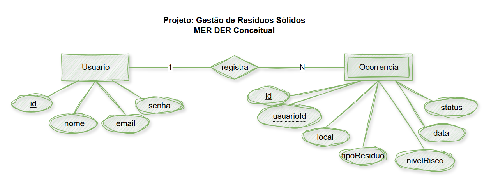

# Tecnologias
|Tecnologias|Utilização|
|--|--|
|VsCode|Programas do Codigo|
|Draw.io|Diagrama de Classes|
|Node.js|Rodar o JavaScript|
|Insominia|Testes do BCD|
|XAMPP|Utilizar o BCD do Mysql|

# Passo a passo para testar
- Clone este repositório em seu pc
- Abra a pasta com um compilador (geralmente VS code)
- Rode o servidor no cmd utilizando o comando npm run dev
- Abra o Insomnia e teste as HTTP requests seguindo o CRUD (Create, Read, Update, Delete), adicionando também o resumo (ocorrencia), login (usuario) e o patch (substitui o PUT no ocorrências)

# Print dos testes com insomnia
# Ocorrencias:
Listar
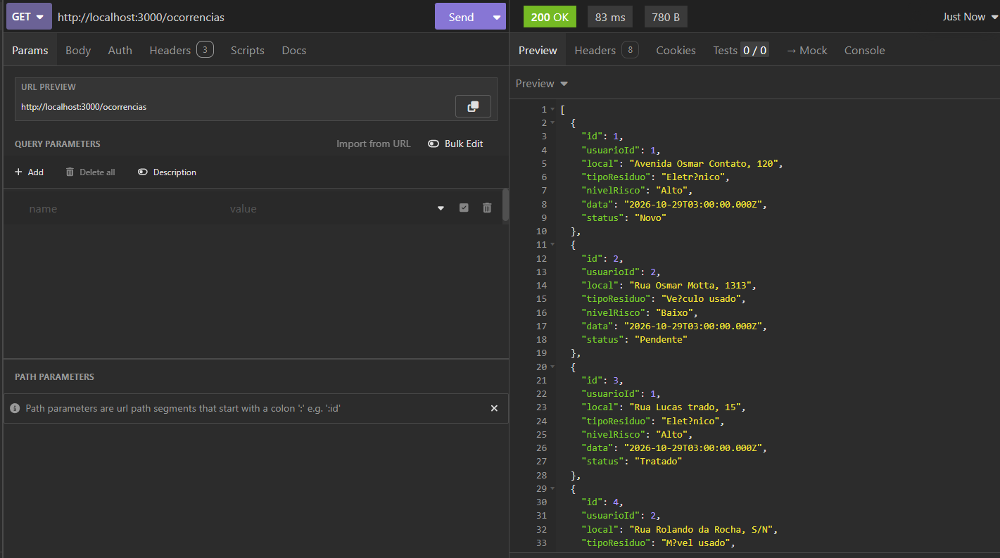
Cadastrar
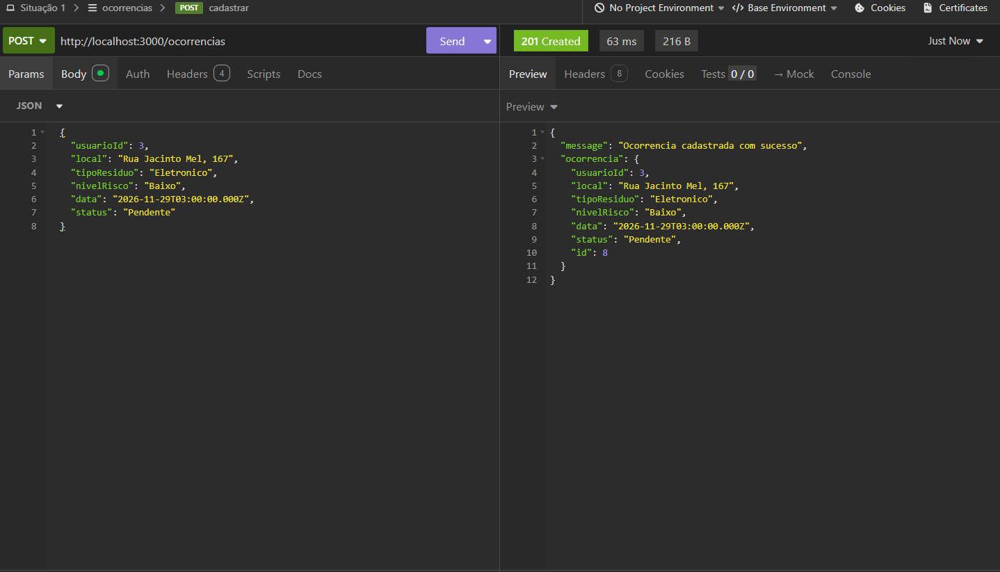
Excluir
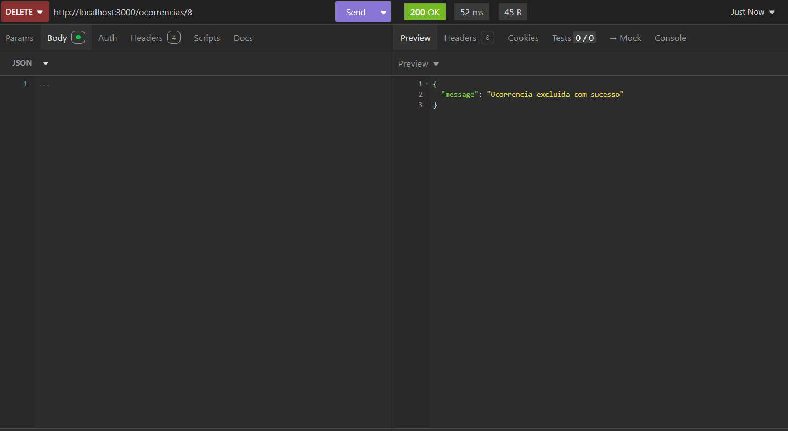
Alterar
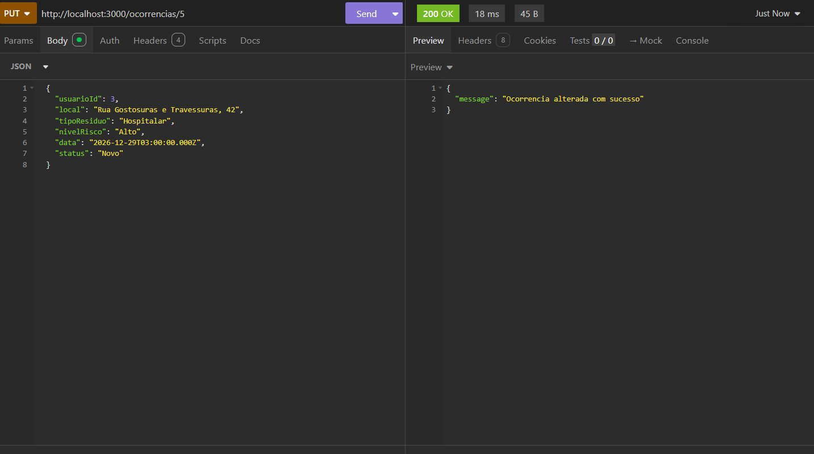
Resumo
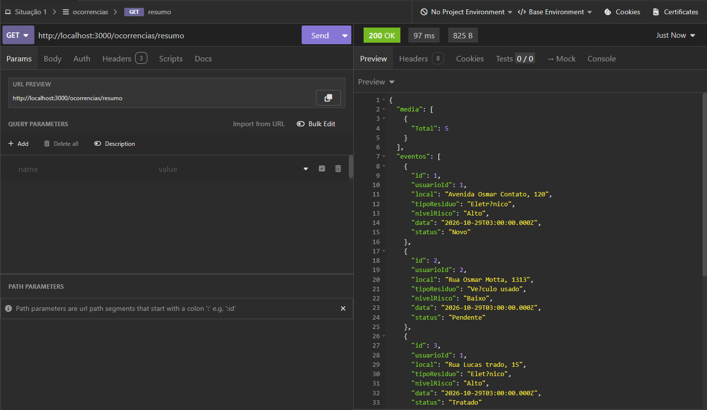

# Usuarios
Listar
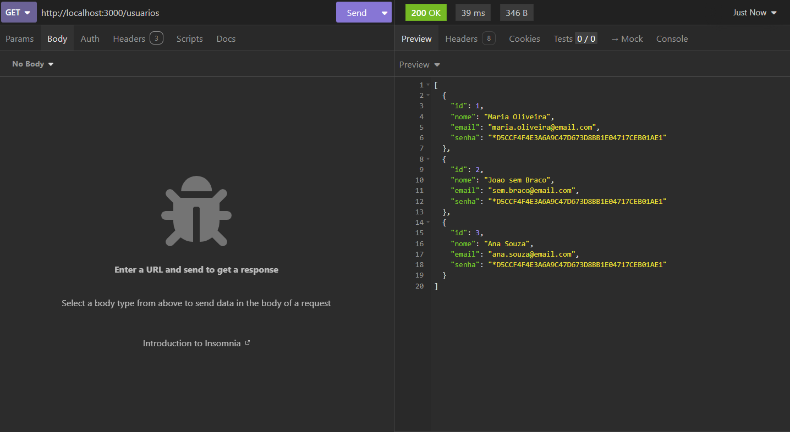
Cadastrar
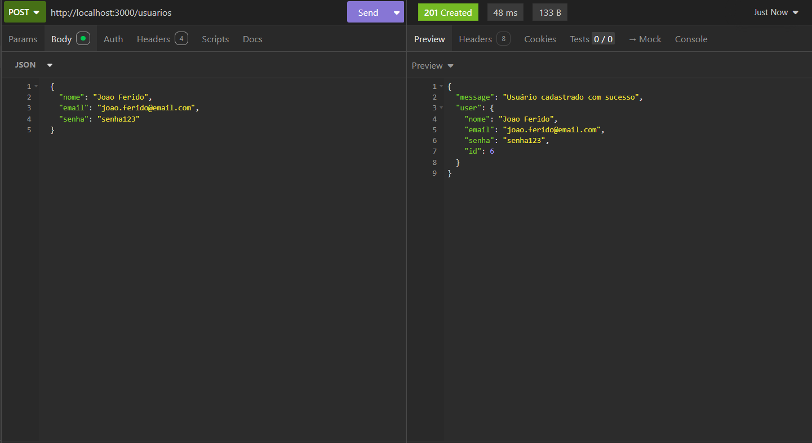
Excluir
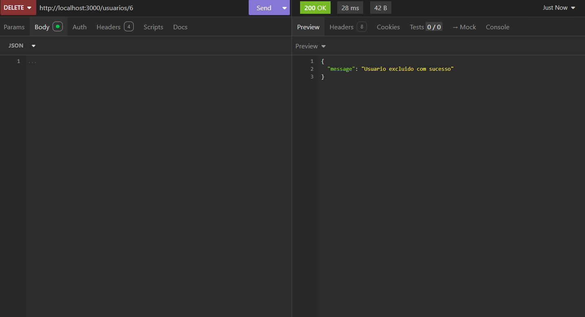
Alterar
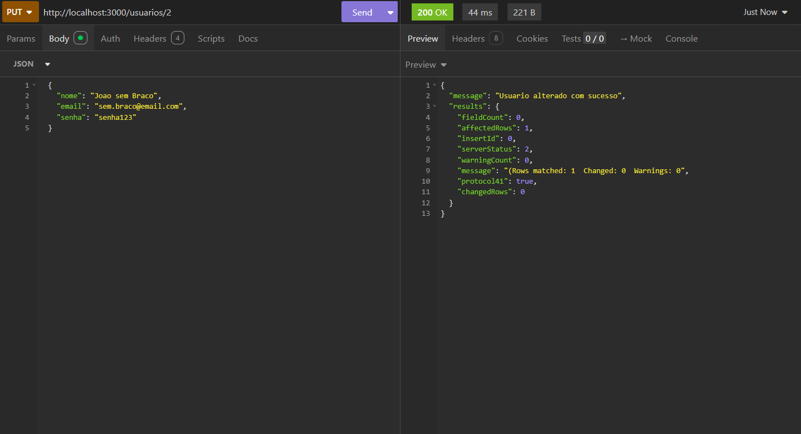
Login
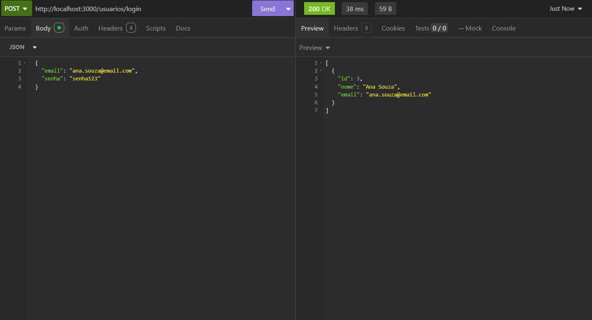
